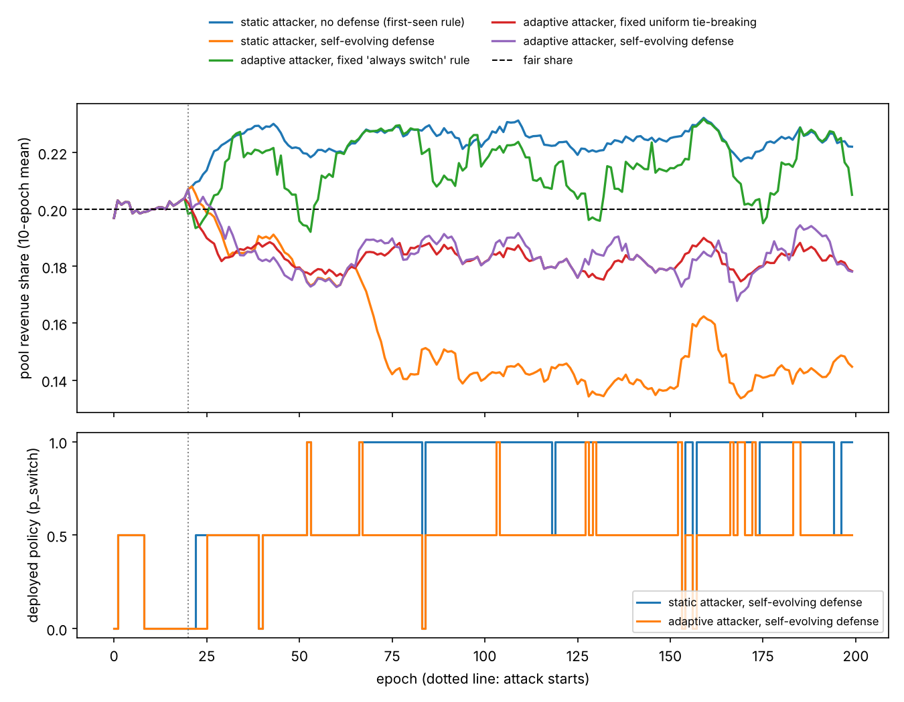

# Self-Evolving Programs

A program that rewrites part of itself while it runs, and a worked example: a defense against selfish
mining in Bitcoin that changes its own fork-choice code as the attack changes.

The project builds on the framework introduced in:

> A. M. Saghiri and N. Wang, "Self-Evolving Programs: A Novel Approach Leveraging LLMs and Quine
> Programs," *2024 International Conference on Computing, Internet of Things and Microwave Systems
> (ICCIMS)*, 2024. doi: [10.1109/ICCIMS61672.2024.10690672](https://doi.org/10.1109/ICCIMS61672.2024.10690672)

**Status of this code.** This is a new prototype, written in 2026 to restart the project. It follows the
four-component architecture of the paper and the paper's application area, but it is not the code used
for the paper, and it does not reproduce the paper's reported figures. The model below is deliberately
simple. What the code does is established by the tests and by the experiment you can run yourself.

## The idea

Most software is fixed once it is deployed. A self-evolving program keeps observing how well it is
doing, decides when its behaviour should change, writes the new code itself, and continues as a new
generation of the same program.

Two ingredients make this possible:

- A **quine** is a program that can output its own source code. Here it is the mechanism of
  reproduction: each generation produces the next one as a copy of itself with one part replaced.
- A **large language model** can supply the replacement code and help interpret what the program
  observes. In this prototype the LLM is optional; without it, a template and a statistical rule are used.

## Architecture

| Component | File | Role |
| --- | --- | --- |
| **Monitoring and Evaluation Unit (MEU)** | `sep/meu.py` | Measures each epoch: stale-block rate, and how much the largest block producer earns above its hash-power share. |
| **Predictive Analysis Module (PAM)** | `sep/pam.py` | Predicts whether an attack is under way. A statistical predictor by default; an LLM predictor is included. |
| **Adaptive Strategy Executor (ASE)** | `sep/ase.py` | Chooses the policy to deploy, with tabular Q-learning. State: predicted threat. Reward: from the MEU. |
| **Self-Replicating Code Generator (SRCG)** | `sep/srcg.py` | Writes the policy code, validates it, and has the current generation reproduce with it. |

One pass of the loop, in `sep/framework.py`:

1. MEU measures the last epoch.
2. PAM turns the measurements into a threat prediction.
3. ASE picks a policy for the next epoch.
4. If the policy changed, SRCG generates the code, checks it, and creates the next generation.
5. The honest nodes run the new generation for an epoch.
6. ASE learns from the reward.

## The application: selfish mining

In selfish mining a pool withholds the blocks it finds and releases them strategically, so that honest
miners waste work on blocks that get orphaned. The pool then earns more than its share of hash power.
How much it earns depends on what honest miners do in a **tie**, when the pool's block and an honest
block compete at the same height.

The evolvable part of the program is that one decision:

```python
def choose_branch(first_seen, later_seen, rng):
    """During a tie, extend the later-seen branch with probability P_SWITCH."""
    if rng.random() < P_SWITCH:
        return later_seen
    return first_seen
```

`P_SWITCH = 0` is Bitcoin's first-seen rule, `0.5` is uniform tie-breaking, and `1` always switches.

### The model

`sep/simulator.py` simulates a network of 100 equal miners, 20 of them colluding as a pool that follows
the SM1 strategy of Eyal and Sirer. A well-connected pool gets its block to an honest miner first 90%
of the time. Two kinds of attacker are modelled:

- **Static**: always tries to be seen first.
- **Adaptive**: can instead time its release to be seen last, and learns which of the two earns more
  against the rule the honest miners are currently using.

The simulator is checked against the closed-form SM1 revenue for nine combinations of pool size and
tie behaviour, and agrees to within 0.004.

## Quick start

Python 3.9 or later. No dependencies; `matplotlib` only if you want the figure.

```bash
python run_experiment.py                         # about 2 seconds
python run_experiment.py --plot results.png      # also draw the figure
python -m unittest discover -s tests -v          # 24 tests
```

## What the experiment shows

Output of `python run_experiment.py` (seed 42, 200 epochs of 3,000 blocks, attack from epoch 20).
Revenue is the pool's share of main-chain blocks over the second half of the attack; its fair share is 0.200.

| Scenario | Pool revenue | Against fair share | Generations | Policy in use |
| --- | --- | --- | --- | --- |
| Static attacker, no defense (first-seen rule) | 0.2238 | +0.0238 | 0 | p=0: 100% |
| Static attacker, **self-evolving defense** | 0.1426 | −0.0574 | 20 | p=1: 93% |
| Adaptive attacker, fixed "always switch" rule | 0.2134 | +0.0134 | 1 | p=1: 100% |
| Adaptive attacker, fixed uniform tie-breaking | 0.1811 | −0.0189 | 1 | p=0.5: 100% |
| Adaptive attacker, **self-evolving defense** | 0.1821 | −0.0179 | 30 | p=0.5: 88% |



Reading the table:

- With the first-seen rule, the pool earns about 12% more than its share, as theory predicts (0.2246).
- Against a static attacker, the defense learns to always switch, which is the best reply to an attacker
  that is always seen first. The pool falls well below its fair share.
- "Always switch" is a predictable rule, and the adaptive attacker exploits it: a fixed version of that
  rule lets the pool profit again.
- Against the adaptive attacker, the self-evolving defense settles on uniform tie-breaking, the rule
  that cannot be exploited by timing, and matches a defense fixed at that rule from the start.

So the program was not told which rule to use in either setting; it arrived at a different one in each.
The same pattern appeared with seeds 1, 7, and 123.

**What this does not show.** The policy space here has three settings, so the learning problem is small.
Uniform tie-breaking is the defense Eyal and Sirer proposed in 2014; the experiment rediscovers a known
answer rather than finding a new one. The attacker and network models are stylised. This is a
demonstration that the loop works end to end, not an evaluation of a new defense.

## The quine

Every generation is a standalone Python file that reproduces its own source without reading itself
from disk:

```bash
python run_experiment.py --keep generations
cd generations/adaptive-attacker-self-evolving-defense
python gen_0003.py                             # show its generation number and policy
python gen_0003.py --emit | diff - gen_0003.py   # no output: the program printed itself exactly
```

Each generation records the SHA-256 of its parent, so the chain of generations can be audited. Between
generations only the policy, the generation number, and the parent hash change; a test checks this.

## Safety of generated code

Policy code is checked before it can enter a generation, whether it came from the template or an LLM:

- **Static check.** Only a small subset of Python is allowed: constants, arithmetic, comparisons,
  `if`/`else`, and `rng.random()`. No imports, no loops, no other calls or attributes. Code in this
  subset always terminates.
- **Behavioural check.** The function is called 4,000 times and must always return one of the two
  branches. Its measured switching probability must match what was requested.
- **Quine check.** A generation is loaded only if it reproduces its own source exactly.

Code from an LLM that fails a check is discarded and the template is used instead.

## Using an LLM

Any OpenAI-compatible endpoint works. The LLM can serve as the predictor, the code writer, or both.

```python
from sep.llm import openai_compatible
from sep.pam import LLMPredictor
from sep.srcg import SelfReplicatingCodeGenerator

llm = openai_compatible()        # reads SEP_LLM_BASE_URL, SEP_LLM_API_KEY, SEP_LLM_MODEL
pam = LLMPredictor(llm)
srcg = SelfReplicatingCodeGenerator("generations", llm=llm)
```

The tests exercise both LLM paths with stand-in functions. They have not been run against a live model.

## Limitations

- The policy space is three values of one parameter. A richer space is where LLM-written code would matter.
- One controller decides for all honest nodes. In a real network each node would learn on its own.
- The reward uses the largest producer's revenue against its estimated hash share. Attributing blocks to
  a producer is easier in a simulator than on a real chain.
- The simulator is a block race, not a network simulator: no propagation delays or natural forks.
- The attacker follows SM1. Optimal selfish-mining strategies are stronger.

## Roadmap

- Per-node learning, building on Q-Defense (see References).
- A larger policy language, so that the LLM proposes structurally new rules and not only parameters.
- A network-level simulator with propagation delay and natural stale blocks.
- Stronger attackers, including optimal selfish mining.
- The same framework applied outside blockchain; see
  [adaptive-shell-scripting](https://github.com/amsaghiri/adaptive-shell-scripting) for operations scripts.

## References

- I. Eyal and E. G. Sirer, "Majority is not enough: Bitcoin mining is vulnerable," *Financial
  Cryptography and Data Security*, 2014.
- A. Nikhalat-Jahromi, A. M. Saghiri, and M. R. Meybodi, "Q-Defense: When Q-Learning Comes to Help
  Proof-of-Work Against the Selfish Mining Attack," 2024. doi: 10.5220/0012378600003636
- Related simulator: [SelfishMining](https://github.com/amsaghiri/SelfishMining).

## Citation

```bibtex
@inproceedings{saghiri2024selfevolving,
  author    = {Saghiri, Ali Mohammad and Wang, Nan},
  title     = {Self-Evolving Programs: A Novel Approach Leveraging LLMs and Quine Programs},
  booktitle = {2024 International Conference on Computing, Internet of Things and Microwave Systems (ICCIMS)},
  year      = {2024},
  doi       = {10.1109/ICCIMS61672.2024.10690672}
}
```

## Author

Ali Mohammad Saghiri, Department of Computer Science, William Paterson University ·
[homepage](https://amsaghiri.github.io/) · [ACBOS Lab](https://amsaghiri.github.io/saghirilab.html)
